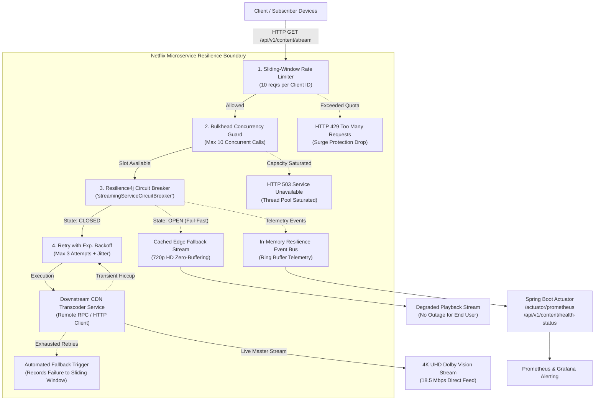

# 🎬 Netflix-Grade Resilience Microservice
### High-Throughput Fault-Tolerant Distributed Streaming Architecture with Spring Boot 3 & Resilience4j

[]()
[]()
[]()
[]()
[]()

> A production-ready, distributed streaming microservice architected to emulate Netflix's fault-tolerance, traffic surge shedding, and graceful service degradation patterns under downstream network partitions, cascading failures, and high concurrency spikes.

---

## 🏛️ System Architecture & Resilience Patterns



---

## ⚙️ Core Technical Capabilities: The Resilience "Holy Trinity"

### 1. Resilient Circuit Breaker (Count-Based Sliding Window)
- **Sliding Window**: Tracks the last 10 requests (`COUNT_BASED`).
- **Failure Threshold**: Automatically trips open if **≥ 50%** of calls fail.
- **Slow Call Threshold**: Flags calls taking longer than **1,500 ms** as slow calls and trips open if slow call rate exceeds **50%**.
- **Fail-Fast Open State**: While `OPEN`, remote calls are short-circuited instantly (0 ms latency), executing automated fallback routines without saturating the downstream service.
- **Half-Open Recovery**: Automatically transitions to `HALF-OPEN` after **5,000 ms**, evaluating **3 trial requests** before fully recovering back to `CLOSED`.

### 2. Bulkhead Concurrency Isolation
- **Resource Segregation**: Restricts in-flight streaming requests to **10 concurrent calls** (`streamingBulkhead`), isolating thread pools to prevent streaming traffic spikes from starving other services (catalog search, user auth).
- **Graceful Saturation**: Instantly drops excess traffic with `BULKHEAD_FULL` fallback when saturated.

### 3. Smart Retry with Exponential Backoff & Jitter
- **Transient Healing**: Retries transient downstream exceptions up to **3 attempts** with a base backoff of **100 ms**, exponential multiplier of $2\times$, and randomized jitter ($0.5$).
- **Anti-Stampede**: Jitter spreads out retried requests across time to prevent the "thundering herd" problem on recovering downstream nodes.

### 4. Client-Isolated Sliding-Window Rate Limiting
- **Client ID Isolation**: Capping requests per client ID (`rateLimiter-{clientId}`) with fallback to the global tenant limiter.
- **Surge Protection**: Configured for **10 requests / second** with **0 ms wait duration**, shedding traffic bursts immediately with an informative `THROTTLED` response.

---

## 📡 REST API Reference

### 1. Stream Content (Protected Endpoint)
```http
GET /api/v1/content/stream
```
#### Parameters
| Parameter | Type | Default | Description |
| :--- | :--- | :--- | :--- |
| `contentId` | `String` | `stranger-things-s5` | Video / movie content identifier |
| `clientId` | `String` | `subscriber-default` | Subscriber ID for client-specific rate limiting |
| `fail` | `boolean` | `false` | Explicitly inject downstream 503 outage |
| `latency` | `long` | `0` | Injected downstream latency (ms) to simulate slow calls |
| `randomFail`| `int` | `0` | Probabilistic failure injection (0 to 100%) |

---

### 2. Live Health Status & Telemetry
```http
GET /api/v1/content/health-status?clientId={clientId}
```

```json
{
  "serviceName": "netflix-resilience-microservice",
  "overallHealth": "HEALTHY (Streaming Service UP - Holy Trinity Active)",
  "circuitBreaker": {
    "name": "streamingServiceCircuitBreaker",
    "state": "CLOSED",
    "failureRateThreshold": "50.0%",
    "slowCallRateThreshold": "50.0%",
    "slowCallDurationThresholdMs": 1500,
    "currentFailureRate": "0.0%",
    "currentSlowCallRate": "0.0%",
    "bufferedCalls": 10,
    "successfulCalls": 10,
    "failedCalls": 0,
    "notPermittedCalls": 0
  },
  "rateLimiter": {
    "name": "rateLimiter-subscriber-101",
    "availablePermissions": 10,
    "numberOfWaitingThreads": 0,
    "limitForPeriod": 10,
    "limitRefreshPeriodMs": 1000
  },
  "bulkhead": {
    "name": "streamingBulkhead",
    "availableConcurrentCalls": 10,
    "maxConcurrentCalls": 10
  },
  "retry": {
    "name": "streamingRetry",
    "maxAttempts": 3,
    "successfulCallsWithoutRetry": 10,
    "successfulCallsWithRetry": 0,
    "failedCallsWithoutRetry": 0,
    "failedCallsWithRetry": 0
  },
  "recentResilienceEvents": [
    "[2026-11-04T23:30:20.100Z] Circuit Breaker Transition: HALF_OPEN -> CLOSED",
    "[2026-11-04T23:30:15.050Z] Retry Attempt #1 for 'streamingRetry' (Waiting 100ms)"
  ],
  "timestamp": 1793818220000
}
```

---

## 🧪 Comprehensive Testing Suite

```bash
mvn test
```

Test suites included:
1. **`CircuitBreakerStateTransitionTest`**: Evaluates `CLOSED -> OPEN -> HALF_OPEN -> CLOSED` state machine transitions.
2. **`RateLimiterSurgeProtectionTest`**: Verifies burst protection and client-level quota isolation.
3. **`BulkheadAndRetryResilienceTest`**: Tests transient error retry recovery, retry exhaustion, and bulkhead concurrent capacity saturation.
4. **`ResilienceControllerIntegrationTest`**: Full Spring Boot MockMvc integration testing of all HTTP routes, actuator endpoints, and error paths.

---

## 🚀 Running Stress Tests

```powershell
./scripts/stress-test.ps1 -TotalRequests 30 -Concurrency 10 -FailPercentage 60 -ClientId "terminal-test"
```

---

## 🐳 Containerization & Docker Deployment

```bash
docker compose up -d
```
- Microservice: `http://localhost:8080`
- Actuator Prometheus Metrics: `http://localhost:8080/actuator/prometheus`
- Prometheus Dashboard: `http://localhost:9090`
