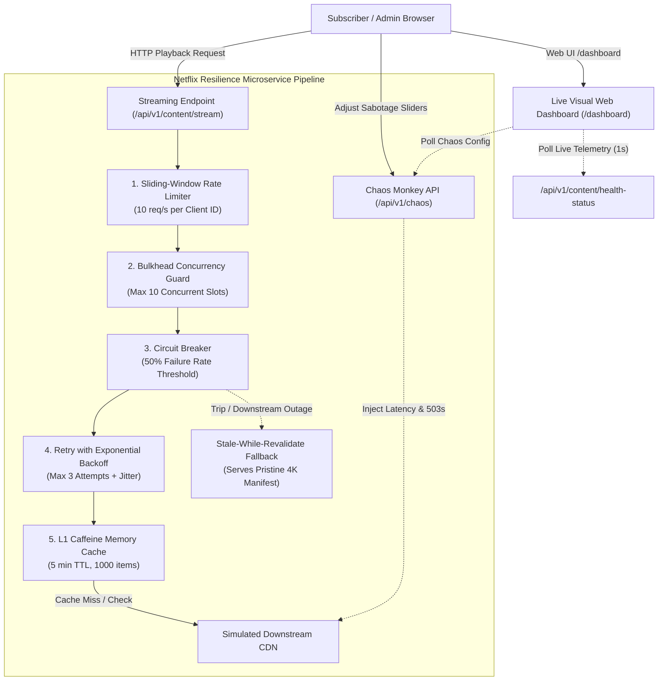

# 🎬 Netflix-Grade Resilience Microservice
### High-Throughput Fault-Tolerant Distributed Streaming Architecture with Spring Boot 3 & Resilience4j

[]()
[]()
[]()
[]()
[]()
[]()

> A production-grade, distributed streaming microservice architected to emulate Netflix's fault-tolerance, traffic surge shedding, Chaos Monkey sabotage injection, Stale-While-Revalidate caching, and real-time visual telemetry dashboards under downstream network partitions and high concurrency bursts.

---

## 🏛️ System Architecture



---

## ⚙️ Core Technical Capabilities

### 1. Resilient Circuit Breaker (Count-Based Sliding Window)
- **Sliding Window**: Tracks the last 10 requests (`COUNT_BASED`).
- **Failure Threshold**: Automatically trips open if **≥ 50%** of calls fail.
- **Slow Call Threshold**: Flags calls taking longer than **1,500 ms** as slow calls and trips open if slow call rate exceeds **50%**.
- **Fail-Fast Open State**: While `OPEN`, remote calls are short-circuited instantly (0 ms latency), executing automated fallback routines without saturating the downstream service.
- **Half-Open Recovery**: Automatically transitions to `HALF-OPEN` after **5,000 ms**, evaluating **3 trial requests** before fully recovering back to `CLOSED`.

### 2. Bulkhead Concurrency Isolation
- **Resource Segregation**: Restricts in-flight streaming requests to **10 concurrent calls** (`streamingBulkhead`), isolating thread pools to prevent streaming traffic spikes from starving other services (catalog search, user auth).
- **Graceful Saturation**: Instantly drops excess traffic with `BULKHEAD_FULL` fallback when saturated.

### 3. Smart Retry with Exponential Backoff & Jitter
- **Transient Healing**: Retries transient downstream exceptions up to **3 attempts** with a base backoff of **100 ms**, exponential multiplier of $2\times$, and randomized jitter ($0.5$).
- **Anti-Stampede**: Jitter spreads out retried requests across time to prevent the "thundering herd" problem on recovering downstream nodes.

### 4. Client-Isolated Sliding-Window Rate Limiting
- **Client ID Isolation**: Capping requests per client ID (`rateLimiter-{clientId}`) with fallback to the global tenant limiter.
- **Surge Protection**: Configured for **10 requests / second** with **0 ms wait duration**, shedding traffic bursts immediately with an informative `THROTTLED` response.

### 5. Interactive Chaos Monkey Control Plane (`/api/v1/chaos`)
- **Runtime Sabotage Toggles**: Dynamically tune failure rates (0% to 100%), artificial latency injection (0–3000ms), latency jitter, and complete downstream network partitions at runtime without restarting the application.
- **Instant Restoration**: One-click reset endpoints to return the system to pristine network conditions.

### 6. Tiered Stale-While-Revalidate Caching (Caffeine L1)
- **Hot L1 Cache**: High-throughput Caffeine cache (5 min TTL, 1000 items).
- **Stale Store**: Retains last known pristine 4K UHD Dolby Vision manifests. When downstream outages occur or the circuit breaker trips `OPEN`, the microservice returns the cached 4K manifest (`status: "STALE_FALLBACK"`, header `X-Cache-Degraded: STALE_FALLBACK`), guaranteeing zero quality degradation for subscribers!

### 7. Single-Page Live Visual Telemetry & Chaos Dashboard (`/dashboard`)
- **Modern Dark-Mode UI**: Built with Netflix branding colors (`#E50914`), glassmorphism cards, and responsive layout.
- **Real-Time Visuals**: Circuit state badge with status glow, live failure rate gauge, token meter for rate limiter, active bulkhead concurrency slots, interactive Chaos Monkey sliders, and an integrated multi-threaded stress-test runner.

---

## 📡 REST API Reference

### Streaming & Playback
| Method | Endpoint | Description |
| :--- | :--- | :--- |
| `GET` | `/api/v1/content/stream` | Fetch video playback manifest protected by full resilience stack |
| `GET` | `/api/v1/content/health-status` | Expose real-time telemetry across circuit breaker, rate limiter, bulkhead, and cache |
| `POST` | `/api/v1/content/simulate-load` | Dispatch concurrent requests to test rate limiting, bulkhead, and circuit breaker trip mechanics |

### Chaos Monkey Control Plane
| Method | Endpoint | Description |
| :--- | :--- | :--- |
| `GET` | `/api/v1/chaos/status` | Get current active chaos configuration and sabotage counters |
| `POST` | `/api/v1/chaos/configure` | Dynamically adjust failure rate (%), latency (ms), and jitter at runtime |
| `POST` | `/api/v1/chaos/partition` | Inject or resolve 100% downstream network blackout partition |
| `POST` | `/api/v1/chaos/reset` | Clear all synthetic chaos and restore normal operations |

### Web Telemetry Dashboard
| Method | Endpoint | Description |
| :--- | :--- | :--- |
| `GET` | `/dashboard` or `/` | Access interactive single-page visual telemetry control center |

---

## 🚀 Quickstart & Docker Execution

### Run Locally with Maven
```bash
mvn clean spring-boot:run
```
Visit `http://localhost:8080/dashboard` in your browser.

### Run with Docker Compose
```bash
docker-compose up --build
```
- **Service & Dashboard**: `http://localhost:8080/dashboard`
- **Prometheus Metrics**: `http://localhost:9090`
- **Actuator Health**: `http://localhost:8080/actuator/health`

---

## 🧪 Running Automated Tests
```bash
mvn test
```
Runs 18 comprehensive unit and integration tests verifying circuit transitions, rate limiting, bulkhead concurrency, retry jitter, chaos monkey injection, and tiered stale caching.
