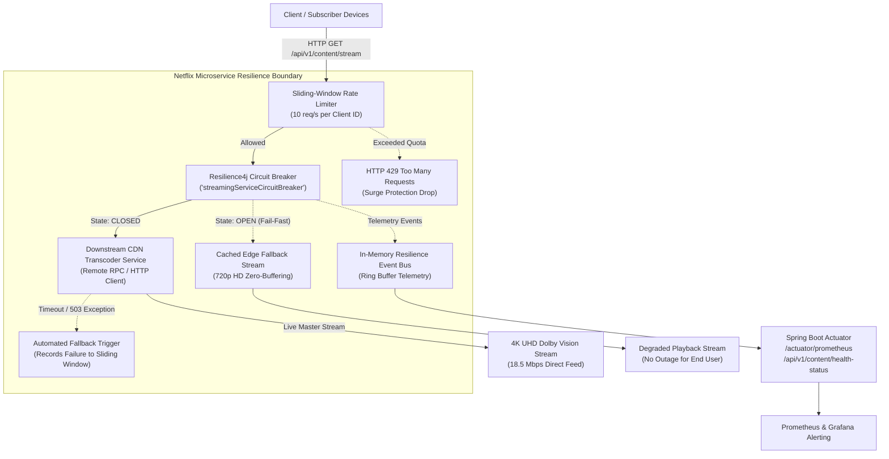

# 🎬 Netflix-Grade Resilience Microservice
### High-Throughput Fault-Tolerant Distributed Streaming Architecture with Spring Boot 3 & Resilience4j

[]()
[]()
[]()
[]()
[]()

> A production-ready, distributed streaming microservice architected to emulate Netflix's fault-tolerance, traffic surge shedding, and graceful service degradation patterns under downstream network partitions, cascading failures, and high concurrency spikes.

---

## 🏛️ System Architecture & Resilience Patterns



---

## ⚙️ Core Technical Capabilities

### 1. Resilient Circuit Breaker (Count-Based Sliding Window)
- **Sliding Window**: Tracks the last 10 requests (`COUNT_BASED`).
- **Failure Threshold**: Automatically trips open if **≥ 50%** of calls fail.
- **Slow Call Threshold**: Flags calls taking longer than **1,500 ms** as slow calls and trips open if slow call rate exceeds **50%**.
- **Fail-Fast Open State**: While `OPEN`, remote calls are short-circuited instantly (0 ms latency), executing automated fallback routines without saturating the downstream service.
- **Half-Open Recovery**: Automatically transitions to `HALF-OPEN` after **5,000 ms**, evaluating **3 trial requests** before fully recovering back to `CLOSED`.

### 2. Client-Isolated Sliding-Window Rate Limiting
- **Client ID Isolation**: Capping requests per client ID (`rateLimiter-{clientId}`) with fallback to the global tenant limiter.
- **Surge Protection**: Configured for **10 requests / second** with **0 ms wait duration**, shedding traffic bursts immediately with an informative `THROTTLED` response.

### 3. Graceful Service Degradation (Netflix Playback Pattern)
- Under upstream outages or network partitioning, users never experience black screens or crashes. The service automatically switches to an Edge Fallback Buffer (720p HD, 2.5 Mbps optimized bitrate).

### 4. Telemetry & Actuator Observability
- Live telemetry endpoint at `/api/v1/content/health-status` streaming:
  - Exact state of the circuit breaker (`CLOSED`, `OPEN`, `HALF_OPEN`).
  - Failure rate percentage and slow call duration percentiles.
  - Number of buffered, successful, failed, and short-circuited calls.
  - Live ring buffer of recent resilience events (state transitions, slow calls, rate limit breaches).
  - Native Prometheus scraping metrics exposed on `/actuator/prometheus`.

---

## 📡 REST API Reference

### 1. Stream Content (Protected Endpoint)
```http
GET /api/v1/content/stream
```
#### Parameters
| Parameter | Type | Default | Description |
| :--- | :--- | :--- | :--- |
| `contentId` | `String` | `stranger-things-s5` | Video / movie content identifier |
| `clientId` | `String` | `subscriber-default` | Subscriber ID for client-specific rate limiting |
| `fail` | `boolean` | `false` | Explicitly inject downstream 503 outage |
| `latency` | `long` | `0` | Injected downstream latency (ms) to simulate slow calls |
| `randomFail`| `int` | `0` | Probabilistic failure injection (0 to 100%) |

#### Sample Responses

**Healthy 4K Stream (Circuit CLOSED):**
```json
{
  "contentId": "stranger-things-s5",
  "clientId": "subscriber-101",
  "title": "Stranger Things Season 5 (Ultra HD Master)",
  "quality": "4K UHD Dolby Vision",
  "bitrate": "18.5 Mbps",
  "status": "OK",
  "message": "High-speed direct streaming active from primary CDN edge node",
  "circuitState": "CLOSED",
  "executionDurationMs": 12,
  "timestamp": 1793646500000
}
```

**Graceful Degradation Fallback (Circuit OPEN or Remote Failure):**
```json
{
  "contentId": "stranger-things-s5",
  "clientId": "subscriber-101",
  "title": "Stranger Things (Pre-Cached Edge Fallback)",
  "quality": "720p HD (Edge Fallback Buffer)",
  "bitrate": "2.5 Mbps (Optimized)",
  "status": "FALLBACK",
  "message": "Graceful Degradation Active: Downstream CDN unavailable [Circuit Breaker OPEN (Fail-Fast Triggered)]. Serving cached edge stream without disruption.",
  "circuitState": "OPEN",
  "executionDurationMs": 2,
  "timestamp": 1793646500050
}
```

---

### 2. Live Health Status & Telemetry
```http
GET /api/v1/content/health-status?clientId={clientId}
```

```json
{
  "serviceName": "netflix-resilience-microservice",
  "overallHealth": "HEALTHY (Streaming Service UP)",
  "circuitBreaker": {
    "name": "streamingServiceCircuitBreaker",
    "state": "CLOSED",
    "failureRateThreshold": "50.0%",
    "slowCallRateThreshold": "50.0%",
    "slowCallDurationThresholdMs": 1500,
    "currentFailureRate": "0.0%",
    "currentSlowCallRate": "0.0%",
    "bufferedCalls": 10,
    "successfulCalls": 10,
    "failedCalls": 0,
    "notPermittedCalls": 0
  },
  "rateLimiter": {
    "name": "rateLimiter-subscriber-101",
    "availablePermissions": 10,
    "numberOfWaitingThreads": 0,
    "limitForPeriod": 10,
    "limitRefreshPeriodMs": 1000
  },
  "recentResilienceEvents": [
    "[2026-11-03T00:15:20.100Z] Circuit Breaker State Transition: HALF_OPEN -> CLOSED",
    "[2026-11-03T00:15:15.050Z] Circuit Breaker State Transition: OPEN -> HALF_OPEN"
  ],
  "timestamp": 1793646510000
}
```

---

### 3. Concurrent Load & Chaos Simulation Endpoint
```http
POST /api/v1/content/simulate-load?totalRequests=30&concurrency=10&failPercentage=60&clientId=load-test-client
```

Dispatches high-concurrency requests across an `ExecutorService` thread pool to verify sliding-window rate-limiting and circuit breaker trip mechanics under load.

---

## 🧪 Comprehensive Testing Architecture

The microservice includes automated JUnit 5 & Mockito test suites:

1. **`CircuitBreakerStateTransitionTest`**:
   - Validates steady-state throughput in `CLOSED` state.
   - Evaluates sliding window failure threshold breach triggering `CLOSED -> OPEN`.
   - Asserts that all subsequent calls fail fast without touching downstream infrastructure.
   - Verifies automated transition from `OPEN -> HALF_OPEN` after timeout.
   - Confirms trial call evaluation and healing back to `CLOSED`.
2. **`RateLimiterSurgeProtectionTest`**:
   - Asserts strict token permission replenishment per sliding window.
   - Verifies immediate `HTTP 429 / THROTTLED` shedding on traffic bursts.
   - Confirms multi-tenant client isolation (one abusive subscriber does not degrade another).
3. **`ResilienceControllerIntegrationTest`**:
   - Full Spring Boot MockMvc integration testing of all HTTP routes, actuator endpoints, and error paths.

### Executing Tests
```bash
mvn test
```

Expected result:
```text
[INFO] Tests run: 9, Failures: 0, Errors: 0, Skipped: 0
[INFO] BUILD SUCCESS
```

---

## 🚀 Running Stress Tests

### Option A: Using the PowerShell Script
```powershell
./scripts/stress-test.ps1 -TotalRequests 30 -Concurrency 10 -FailPercentage 60 -ClientId "terminal-test"
```

### Option B: Running via Standalone Java Runner
```bash
mvn spring-boot:run -Dspring-boot.run.arguments="--spring.profiles.active=loadtest"
```

---

## 🐳 Containerization & Docker Deployment

### Multi-Stage Docker Build
```bash
docker build -t netflix-resilience-service:latest .
```

### Run Distributed Stack (App + Prometheus)
```bash
docker compose up -d
```
- Microservice: `http://localhost:8080`
- Actuator Prometheus Metrics: `http://localhost:8080/actuator/prometheus`
- Prometheus Dashboard: `http://localhost:9090`
